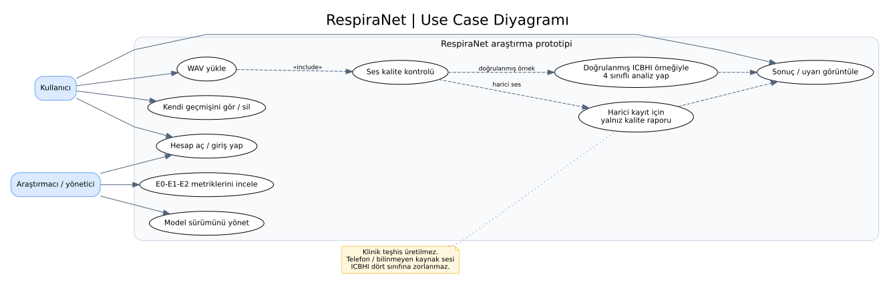
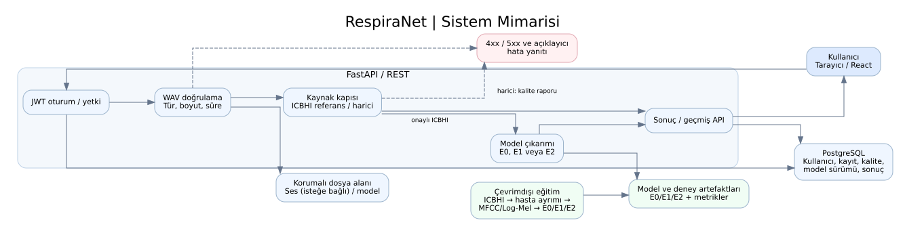
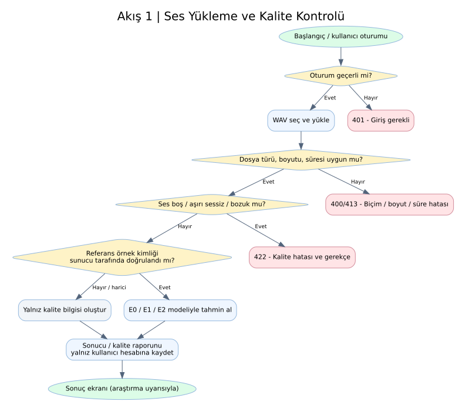
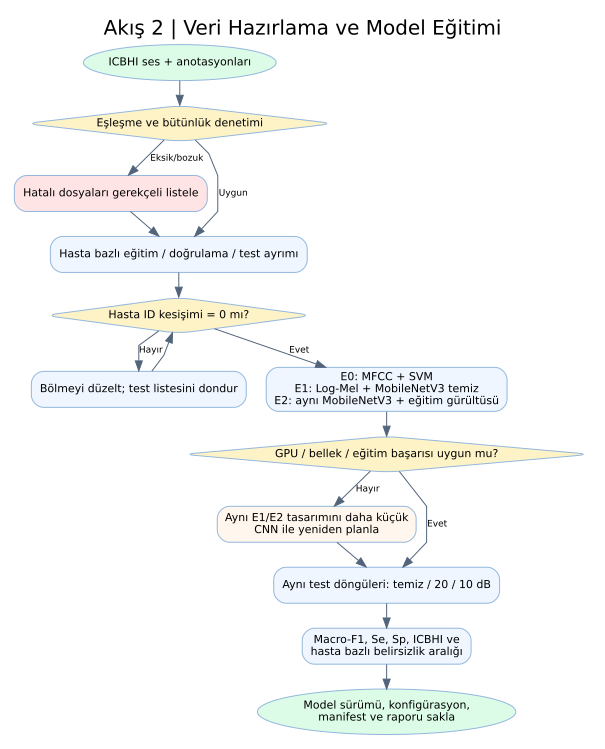
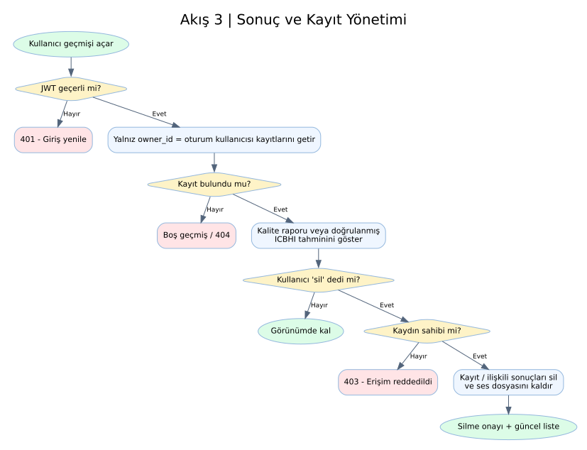
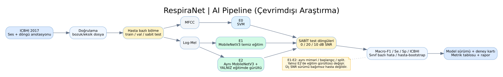

# Hafta 1 — Diyagramlar (6 adet)

İlk haftanın teslimi `docs/hafta-1/diyagramlar` klasöründedir. Her diyagram için düzenlenebilir **Graphviz DOT** (`.dot`), GitHub'ın Markdown içinde görüntüleyebildiği **Mermaid** (`.mmd`) ve görsel (`.svg`, `.png`) çıktı bulunur.

| Diyagram | Açıklama | Görsel | Kaynak |
|---|---|---|---|
| 1. Use Case | Kullanıcı, araştırmacı/yönetici ve işlem sınırları | [SVG](diyagramlar/01_use_case.svg) | [Mermaid](diyagramlar/01_use_case.mmd) |
| 2. Sistem mimarisi | React–FastAPI–PostgreSQL, model, saklama ve hata akışı | [SVG](diyagramlar/02_sistem_mimarisi.svg) | [Mermaid](diyagramlar/02_sistem_mimarisi.mmd) |
| 3. Akış: Yükleme/kalite | Oturum, dosya, sessizlik, kaynak doğrulama ve 401/413/422 | [SVG](diyagramlar/03_akis_ses_yukleme.svg) | [Mermaid](diyagramlar/03_akis_ses_yukleme.mmd) |
| 4. Akış: Eğitim | Anotasyon, hasta ayrımı, E0/E1/E2 ve GPU B planı | [SVG](diyagramlar/04_akis_egitim.svg) | [Mermaid](diyagramlar/04_akis_egitim.mmd) |
| 5. Akış: Sonuç/geçmiş | 401/403/404, sahiplik kontrolü ve silme | [SVG](diyagramlar/05_akis_sonuc_gecmis.svg) | [Mermaid](diyagramlar/05_akis_sonuc_gecmis.mmd) |
| 6. AI Pipeline | Hasta bazlı veri ayrımı, E0-E1-E2 ve test SNR | [SVG](diyagramlar/06_ai_pipeline.svg) | [Mermaid](diyagramlar/06_ai_pipeline.mmd) |

## Tasarım kararları

- **E0:** MFCC + SVM başlangıç karşılaştırması.
- **E1:** Log-Mel + MobileNetV3-Small (yalnız temiz kayıtlarla eğitim).
- **E2:** Aynı ağ ve eğitim ayarları, yalnız eğitim girdisinde kontrollü gürültü.
- Testte her iki ağ için **aynı hasta bazlı sabit** ICBHI örnekleri; temiz, 20 dB ve 10 dB sürümleri.
- Harici / telefon kayıtlarının dört sınıflı klinik tanıya eşdeğer olduğu **varsayılmaz**.
- Akış diyagramlarındaki hata kodları **planlanan API sözleşmesidir**; henüz canlı servis değildir.

## GitHub Issues

Kök dizindeki `issues.json` içinde 21 görev taslağı vardır; bunların 6'sı doğrudan diyagramlara ayrılmıştır. Repoya aktarım için `scripts/create_github_issues.py` kullanılabilir.

## GitHub'da önizleme

### Use Case

### Sistem mimarisi

### Akış 1: Ses yükleme

### Akış 2: Eğitim

### Akış 3: Sonuç ve geçmiş

### AI pipeline

